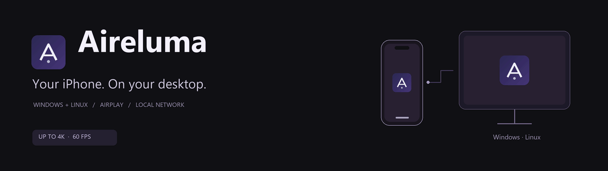
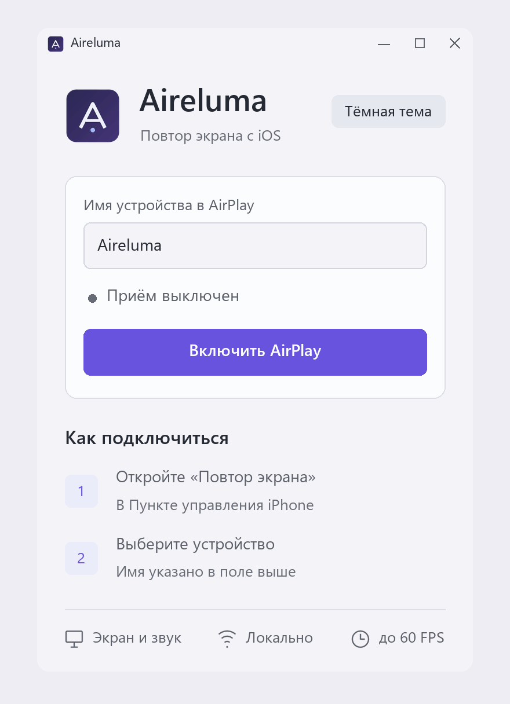
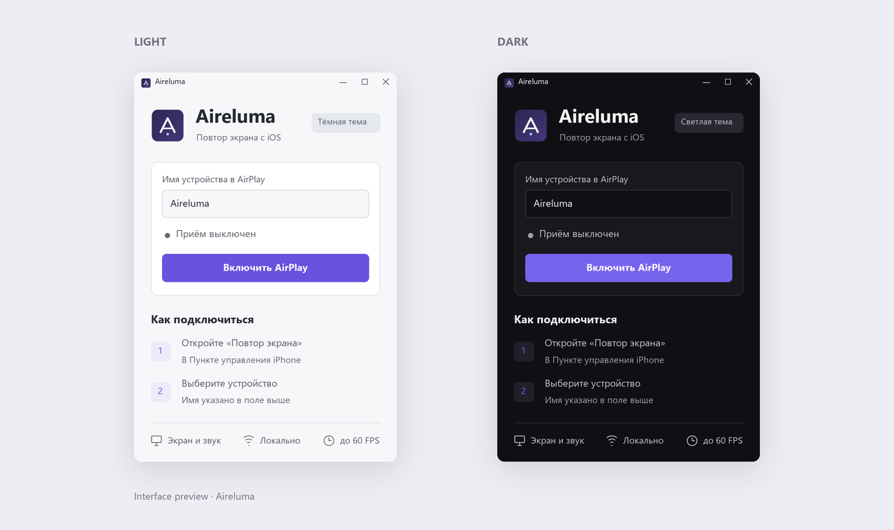

<div align="center">
  <picture><source media="(prefers-reduced-motion: reduce)" srcset="docs/images/banner.png"></picture>
  <p><strong>Your iPhone. On your PC.</strong><br>Screen and sound over your local network.</p>
  <p>
    <a href="https://github.com/Anchoder/Aireluma/releases/latest"></a>
    
    
    <a href="https://github.com/Anchoder/Aireluma/actions/workflows/linux.yml"></a>
    <a href="LICENSE"></a>
  </p>
  <p><a href="https://github.com/Anchoder/Aireluma/releases/latest/download/Aireluma-Setup.exe"><strong>Windows installer</strong></a> · <a href="https://github.com/Anchoder/Aireluma/releases/latest/download/Aireluma_0.8.0_amd64.deb"><strong>Linux .deb</strong></a> · <a href="docs/README.ru.md">Русский</a> · <a href="https://github.com/Anchoder/Aireluma/issues">Report an issue</a></p>
</div>

## A small receiver for your desktop

Aireluma brings iPhone screen mirroring and audio to Windows and Linux through AirPlay. Open it, enable reception, and select Aireluma from Screen Mirroring on your iPhone.

| Feature | What you get |
| --- | --- |
| Screen and audio | Mirror your iPhone with sound on your PC |
| Up to 4K / 60 FPS | Request HEVC and a high-quality stream from your device |
| Light and dark | Smooth light-to-dark transitions; your choice is remembered |
| Local network | Reception works on your LAN; a wired PC is supported |
| System tray on Windows | Keep receiving after closing the control window |
| Native playback | Direct3D12 on Windows; GStreamer video playback on Linux |

Resolution, codec and frame rate are negotiated by the iPhone and depend on your device, network and computer. The requested maximum is not a guaranteed output mode.

## Two themes. One compact interface.

<div align="center"><picture><source media="(prefers-reduced-motion: reduce)" srcset="docs/images/themes.png"></picture></div>

<details><summary>See both themes side by side</summary></details>

## Install

**Windows 10/11 x64:** download [Aireluma-Setup.exe](https://github.com/Anchoder/Aireluma/releases/latest/download/Aireluma-Setup.exe) and run the installer. Direct3D12 is required.

**Ubuntu 24.04 x64:** download [the Debian package](https://github.com/Anchoder/Aireluma/releases/latest/download/Aireluma_0.8.0_amd64.deb), then install it with its dependencies:

```sh
sudo apt install ./Aireluma_0.8.0_amd64.deb
```

Open Aireluma from your application menu. To uninstall: `sudo apt remove aireluma`. Other Linux distributions can use the [source build instructions](docs/BUILDING.md). The prebuilt Linux package is built and checked on Ubuntu 24.04.

## Get connected

1. Download **Aireluma-Setup.exe** from the [latest release](https://github.com/Anchoder/Aireluma/releases/latest) and install it.
2. Open Aireluma and select **«Включить AirPlay»**.
3. Connect your iPhone and PC to the same local network. The PC can use Ethernet.
4. On your iPhone, open **Control Center → Screen Mirroring → Aireluma**.

The current interface is in Russian. On Windows, closing the window keeps Aireluma in the tray; use the tray menu to exit. On Linux, closing the window stops reception and exits.

## Before opening an issue

- **Receiver missing:** check that both devices are on the same LAN and that the router is not isolating clients. Allow the receiver through the firewall only on a trusted network.
- **A particular video is blank:** some apps restrict screen capture or use a separate AirPlay media route. Test a local video in Photos to compare.
- **Frame rate varies:** source content, wireless conditions and device load affect the actual stream.

The installer is currently unsigned. A SHA-256 checksum is included with each release.

## Build and contribute

The interface is written in Rust using Win32 on Windows and GTK4 on Linux. The receiver is based on [UxPlay](https://github.com/FDH2/UxPlay), with GStreamer for playback. See [the build guide](docs/BUILDING.md) for dependencies, the pinned upstream source, and the published receiver patch.

Bug reports with Windows and iOS versions, a short reproduction, and whether Photos playback works are welcome. Avoid posting personal network information or private screen content.

## License and credits

[GPL-3.0-or-later](LICENSE). UxPlay and bundled libraries retain their respective copyright and license notices; see [NOTICE](NOTICE) and [the runtime package manifest](engine/runtime-packages.json). The release includes the installer, SHA-256 checksum and a source bundle.

AirPlay, iPhone and iOS are trademarks of Apple Inc. Aireluma is an independent project, not affiliated with or endorsed by Apple.
