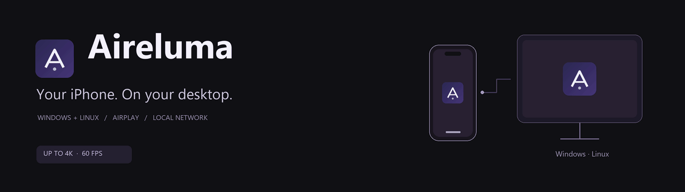

<div align="center">
  <picture><source media="(prefers-reduced-motion: reduce)" srcset="images/banner.png"></picture>
  <p><strong>Экран и звук iPhone на компьютере. Без проводов.</strong></p>
  <p><a href="https://github.com/Anchoder/Aireluma/releases/latest/download/Aireluma-Setup.exe">Windows</a> · <a href="https://github.com/Anchoder/Aireluma/releases/latest/download/Aireluma_0.8.0_amd64.deb">Linux .deb</a> · <a href="../README.md">English</a> · <a href="https://github.com/Anchoder/Aireluma/issues">Сообщить о проблеме</a></p>
</div>

## Возможности

- Повтор экрана и звука iPhone по AirPlay в локальной сети.
- Приём с запросом HEVC, разрешения до 4K и частоты до 60 FPS.
- Светлая и тёмная темы с плавным переходом и сохранением выбора.
- Работа в трее после закрытия окна на Windows.
- Автоматическое окно просмотра: Direct3D12 на Windows, GStreamer на Linux.
- Обычный установщик и удаление через параметры Windows.

Фактическое разрешение, кодек и частоту выбирает iPhone. Результат зависит от устройства, сети и компьютера. Некоторые приложения ограничивают захват или используют отдельный маршрут AirPlay для видео; такой контент может не отображаться.

<div align="center"><picture><source media="(prefers-reduced-motion: reduce)" srcset="images/themes.png"></picture></div>

## Установка на Linux

Готовый пакет рассчитан на **Ubuntu 24.04 x64**. Скачайте `.deb` из [релиза](https://github.com/Anchoder/Aireluma/releases/latest) и установите:

```sh
sudo apt install ./Aireluma_0.8.0_amd64.deb
```

Приложение появится в меню программ. Удаление: `sudo apt remove aireluma`. Сборка для других дистрибутивов описана в [BUILDING.md](BUILDING.md). На Linux закрытие окна останавливает приёмник и завершает приложение.

## Подключение

1. Скачайте установщик из [последнего релиза](https://github.com/Anchoder/Aireluma/releases/latest).
2. Установите Aireluma, запустите её и нажмите **«Включить AirPlay»**.
3. Подключите iPhone и компьютер к одной локальной сети. Компьютер может использовать Ethernet.
4. На iPhone откройте **Пункт управления → Повтор экрана** и выберите **Aireluma**.

Для Windows нужны версия 10/11 x64 и поддержка Direct3D12. Если приёмник не виден, проверьте, что устройства находятся в одной сети и роутер не изолирует клиентов. При разрешении доступа брандмауэра выбирайте только доверенную домашнюю сеть.

## Исходники

Интерфейс написан на Rust: Win32 API для Windows и GTK4 для Linux. Приём обеспечивает [UxPlay](https://github.com/FDH2/UxPlay), воспроизведение — GStreamer. Инструкция сборки: [BUILDING.md](BUILDING.md). Установщик опубликован в релизах; большие двоичные зависимости не хранятся в Git.

Проект распространяется под [GPL-3.0-or-later](../LICENSE). Лицензии сторонних компонентов сохраняются. Aireluma — независимый проект, не связанный с Apple.
