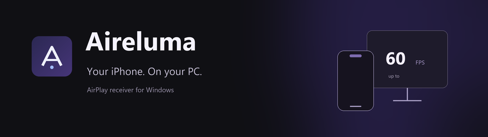
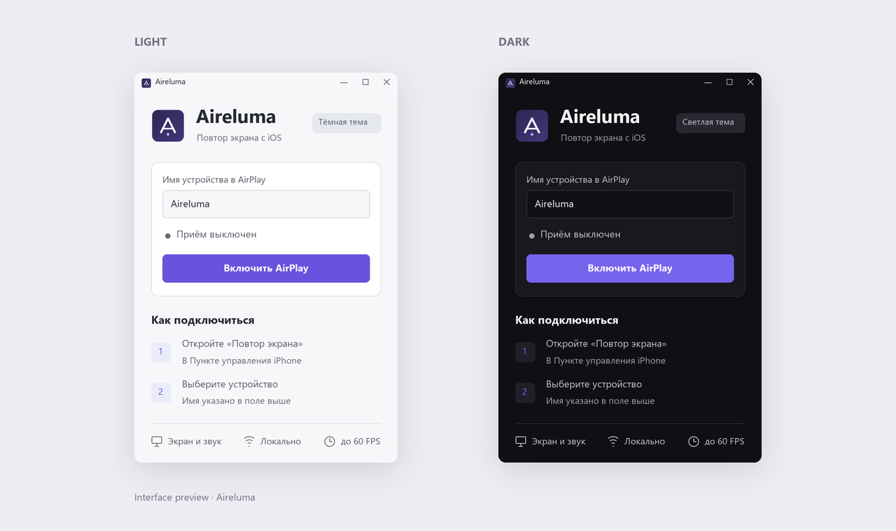

  
  
<strong>Экран и звук iPhone на компьютере. Без проводов.</strong>

  
<a href="https://github.com/Anchoder/Aireluma/releases/latest/download/Aireluma-Setup.exe">Скачать для Windows</a> · <a href="../README.md">English</a> · <a href="https://github.com/Anchoder/Aireluma/issues">Сообщить о проблеме</a>

## Возможности

- Повтор экрана и звука iPhone по AirPlay в локальной сети.
- Приём с запросом HEVC, разрешения до 4K и частоты до 60 FPS.
- Светлая и тёмная темы с сохранением выбора.
- Работа в трее после закрытия окна.
- Автоматическое окно просмотра Direct3D12 с названием и значком Aireluma.
- Обычный установщик и удаление через параметры Windows.

Фактическое разрешение, кодек и частоту выбирает iPhone. Результат зависит от устройства, сети и компьютера. Некоторые приложения ограничивают захват или используют отдельный маршрут AirPlay для видео; такой контент может не отображаться.

## Подключение

1. Скачайте установщик из [последнего релиза](https://github.com/Anchoder/Aireluma/releases/latest).
2. Установите Aireluma, запустите её и нажмите **«Включить AirPlay»**.
3. Подключите iPhone и компьютер к одной локальной сети. Компьютер может использовать Ethernet.
4. На iPhone откройте **Пункт управления → Повтор экрана** и выберите **Aireluma**.

Нужны Windows 10/11 x64 и поддержка Direct3D12. Если приёмник не виден, проверьте, что устройства находятся в одной сети и роутер не изолирует клиентов. При разрешении доступа брандмауэра выбирайте только доверенную домашнюю сеть.

## Исходники

Интерфейс написан на Rust с Win32 API. Приём обеспечивает [UxPlay](https://github.com/FDH2/UxPlay), воспроизведение — GStreamer. Инструкция сборки: [BUILDING.md](BUILDING.md). Установщик опубликован в релизах; большие двоичные зависимости не хранятся в Git.

Проект распространяется под [GPL-3.0-or-later](../LICENSE). Лицензии сторонних компонентов сохраняются. Aireluma — независимый проект, не связанный с Apple.
